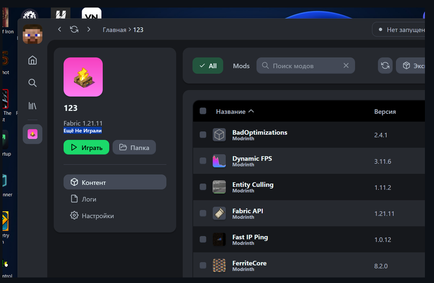

# WinModing

**A Modrinth App fork with CurseForge, RF-friendly relays, and in-launcher servers.**

WinModing is a Windows desktop launcher based on the Modrinth App UI (Theseus / AstralRinth lineage), extended for players who need Modrinth **and** CurseForge in one place — including networks where official APIs are unreliable. You never paste API keys. Microsoft login uses the public Minecraft Xbox client.

<p align="center">
  
</p>



## What you get

- **Modrinth fork UI** — familiar Browse / Library / instance flow from the Modrinth App family
- **Modrinth + CurseForge** in the same catalog (or one source at a time)
- **RF / restricted-network bypasses** — Millida Modrinth & CurseForge relays, mirrors, and sticky-host failover when `api.modrinth.com` / ForgeCDN stall
- **Servers in the launcher** — curated RF + abroad list, Millida rating catalogue, custom IPs, native Java SLP ping, one-click join into a selected profile
- Isolated profiles: mods, saves, and config stay per instance
- From Browse (not inside a profile), **Download** saves jars into the launcher folder, not into a Minecraft instance
- Fabric, Quilt, Forge, and NeoForge
- Microsoft, Ely.by, and offline accounts — no Azure app setup
- Optional Fabric/Quilt **auto-optimize** pack (version-matched Sodium/Lithium/… only — no mismatched jars)
- Skin wardrobe with 3D preview (`skinview3d`)
- Discord shows **Playing Minecraft** only while the game is running
- Playtime on the profile, in hours
- No telemetry, analytics, or ads

## Requirements

- Windows 10 or 11
- [WebView2](https://developer.microsoft.com/microsoft-edge/webview2/)

To build from source: Rust 1.77+ and Node.js 20+.

## Install

Download **WinModing.exe** from [Releases](https://github.com/vithorixscom-debug/WinModing/releases). Put a shortcut wherever you like; user data stays under `%LOCALAPPDATA%\WinModing`.

## Build

```bash
npm install --legacy-peer-deps
npm run build
cd src-tauri
cargo build --release
```

Development:

```bash
npm install --legacy-peer-deps
npm run tauri dev
```

The release binary is `WinModing.exe`. Bundled installers: `npm run tauri build`.

## User data

| Path | Contents |
| --- | --- |
| `%LOCALAPPDATA%\WinModing` | Instances, Java runtimes, metadata, database |
| `%LOCALAPPDATA%\WinModing\instances\<id>` | One Minecraft profile |
| `%LOCALAPPDATA%\WinModing\downloads` | Jars saved from Browse without installing into a profile |

## Disclaimer

WinModing is not affiliated with Mojang, Microsoft, Modrinth, CurseForge, Millida, or AstralRinth. Minecraft is a trademark of Mojang Synergies AB. Catalog relays are used only to reach public mod/server metadata and files; they are not an official Modrinth or CurseForge product.

## License

WinModing is free software licensed under the [GNU General Public License v3.0](LICENSE).

The UI under `packages/` is vendored from Modrinth (Theseus) / AstralRinth and is also GPL-3.0.
